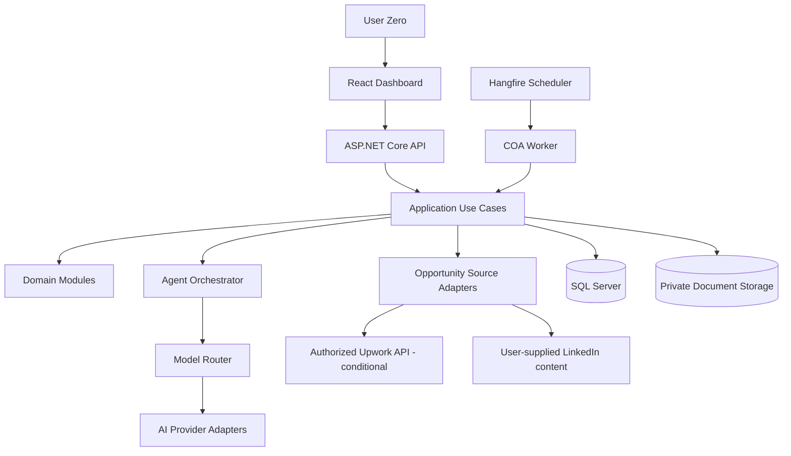

# COA — Architecture Overview

Status: Proposed / Draft  
Tracking: #3 (parent #1)  
Product requirements: #2 (draft PR #7; subject to approval)

## Architecture goal
Build a maintainable, observable **modular monolith** for the User Zero MVP, while preserving seams for a future commercial SaaS. The product is in validation; do not implement premature billing, complex tenant administration, or per-agent microservices.

## Logical topology

The diagram is logical: the API and worker may share application assemblies while running as separate processes. Domain modules are **not** independently deployed services.

## Modules
| Module | Responsibility | Owns |
|---|---|---|
| Profile | CV ingestion, verified skills, projects, preferences, constraints | Profile aggregate and versions |
| Opportunities | Source ingestion, normalization, deduplication, requirement snapshots | Opportunity and source records |
| Matching | Evidence-based assessment, hard constraints, deterministic scores, review outcomes | Assessment and scoring-policy versions |
| Applications | Draft generation and human review; **no submission** | Application drafts |
| Agents | Orchestration, prompts, typed results, model routing, execution audit | Agent execution metadata |
| Reporting (application capability) | Daily shortlist, run status, human decisions | Report snapshots and decision history |

These are logical ownership boundaries; physical projects should be chosen only when boundaries justify them. Avoid one assembly per agent.

## Architectural principles
1. Dependency direction: API/Worker → Application → Domain; Infrastructure implements application/domain ports.
2. Business rules, hard constraints, and final scoring are deterministic and testable; LLMs assist extraction, reasoning, and critical review.
3. Persist source snapshots and evidence for explainability and reproducibility.
4. Unknown/NotProven is distinct from Missing; never promote model speculation into verified facts.
5. Opportunity descriptions and CV text are untrusted input, not instructions.
6. Provider integrations and AI capabilities are behind typed interfaces.
7. Explicit human control: the MVP exposes draft preparation, never application submission.
8. Operational simplicity: one SQL Server database, bounded retries, idempotent processing, observable background jobs.

## Proposed deployables
- **COA.Web**: React static frontend (hosting choice deferred).
- **COA.Api**: ASP.NET Core API, auth, use-case endpoints.
- **COA.Worker**: Hangfire background job host.
- **SQL Server**: transactional source of truth.
- **Private document storage**: CV uploads, with access controls.
- **External services**: authorized opportunity providers and AI model endpoints.

## Delivery and evolution
Start with local Docker-based development and a deployment topology compatible with Azure. Defer Kubernetes and distributed messaging until operational evidence justifies them. Before private beta, revisit identity, data retention/deletion, access isolation, rate limits, and abuse prevention.

## Open decisions
- Authentication/authorization approach and identity provider.
- CV storage choice and retention policy.
- Whether vector search is necessary for initial evaluation volume.
- Upwork API eligibility and allowed usage.
- Quantified performance and cost budgets after baseline benchmarks.
- When multi-user isolation should be introduced (before private beta).

## Traceability
FR-01..12 and NFR-01..10 in #2; architecture proposal in #3; decisions requiring trade-off review in #4.