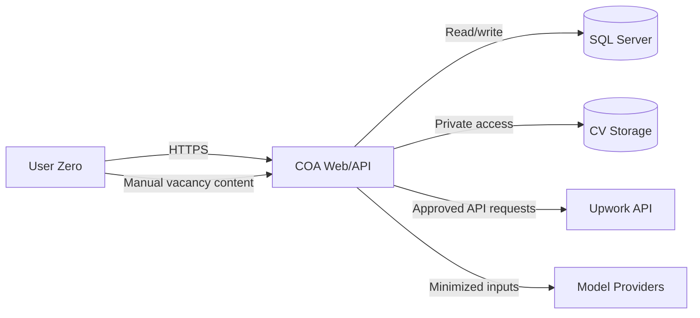

# COA — System Context and Trust Boundaries

Status: Proposed / Draft  
Tracking: #3

## Actors and external systems
| Actor/system | Interaction | Trust classification |
|---|---|---|
| User Zero | Upload CV, set preferences, review recommendations, record decisions | Authenticated user |
| React Dashboard | Display/edit profiles, opportunities, reports, drafts | Public-facing client; never trusted for authorization |
| Upwork API | Opportunity ingestion only if official access and scope are approved | External service; response content untrusted |
| LinkedIn manual import | User supplies URL and vacancy text | User-provided external content; untrusted |
| NVIDIA NIM / other models | Structured extraction, reasoning, embeddings, reranking, parsing | External processors; send minimized data |
| SQL Server | Persist domain data and execution metadata | Controlled persistence boundary |
| Private document storage | Store uploaded CVs | Sensitive data boundary |

## Context diagram

## Trust-boundary rules
- Authorize every user-scoped API operation on the server; the UI does not establish authorization.
- CV files and vacancy descriptions must be validated, size-limited, and treated as data.
- Prompt templates and scoring policies are versioned trusted configuration; no external content may alter them.
- Validate model outputs against typed schemas and reject malformed/unjustified outputs.
- Mask or omit contact details and secrets before model calls where feasible.
- Never expose provider API keys to React clients.
- Do not log raw CVs, credentials, or full private prompts by default.
- Any future multi-user version requires tenant/user ownership enforcement at query and storage boundaries.

## Application approval boundary
The only supported MVP operation is to create/edit a draft. No API endpoint, background job, or provider adapter should be capable of submitting applications or recruiter messages. Adding that capability requires a new reviewed product/security decision and explicit user authorization.

## Source compliance
- Upwork: conditional official API access; disable automated ingestion until approved.
- LinkedIn: user-provided URL/description only; no unauthorized scraping or browser automation.
- Source URLs and original content provenance are retained for audit, subject to retention policy.

## Open questions
Authentication method, consent/retention/deletion rules, third-party processing terms, and permitted provider data use must be resolved before private beta.