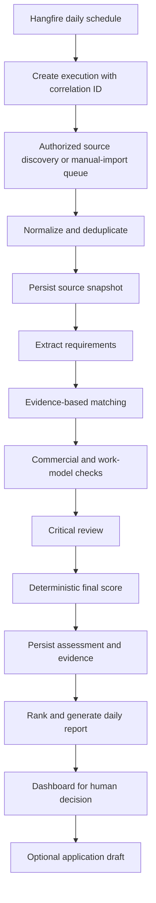

# COA — Workflows, Reliability and Observability

Status: Proposed / Draft  
Tracking: #3

## Daily opportunity intelligence

## Scheduling
- Hangfire is the initial scheduler candidate, with daily execution in **Europe/Lisbon**.
- The job must support manual re-run and be safe against duplicate execution.
- Manual LinkedIn imports enter the same normalization/assessment pipeline.
- When Upwork access is unavailable, report that discovery source as disabled; do not silently claim successful ingestion.

## Idempotency and identity
- Primary identity: (provider, external opportunity ID) when available.
- Fallback: canonical source URL and conservative metadata fingerprint; collisions require review.
- Separate an opportunity identity from its immutable source-content snapshots.
- Reprocessing the same snapshot with the same profile and policy version should not create conflicting assessments.

## State and recovery
Suggested states: Discovered → Normalized → Assessed → Reported; Failed/NeedsReview are explicit states with error metadata. Intermediate extraction/matching state may be tracked separately rather than overloading the opportunity's business state.
- Bound retry count with exponential backoff for transient network/provider errors.
- Do not retry invalid input or policy violations indefinitely.
- Resume from persisted checkpoints after process restart.
- Capture partial daily report status when some sources/assessments fail.

## Observability
- CorrelationId and ExecutionId link discovery, assessment, and report generation.
- Record provider/model, prompt version, duration, token usage and estimated cost where available.
- Metrics: ingestion success/failure, duplicates, assessment latency, model error rate, unsupported-claim rate, daily-run success, cost/opportunity.
- Logs contain IDs and sanitized diagnostics, not raw private CVs or credentials.

## Human feedback
- User can save/reject opportunities with a reason; store timestamp and policy version.
- Feedback supports future evaluation/calibration; it must not silently rewrite historical scores.
- Application drafting is a separate, human-triggered step.

## Failure scenarios to test
1. Provider unavailable or quota exhausted.
2. Duplicate opportunities from different imports.
3. Invalid or malicious vacancy text.
4. Malformed or unsupported model output.
5. Model timeout midway through batch.
6. SQL transient failure after an external model call.
7. Profile updated while assessment is running.
8. Scheduled run overlaps a manual run.
9. Hard constraint contradicts high technical fit.
10. Partial report with failed source ingestion.

## Outstanding decisions
Set quantitative SLAs after baseline measurements; select the notification channel and precise failure-alert policy during implementation planning.